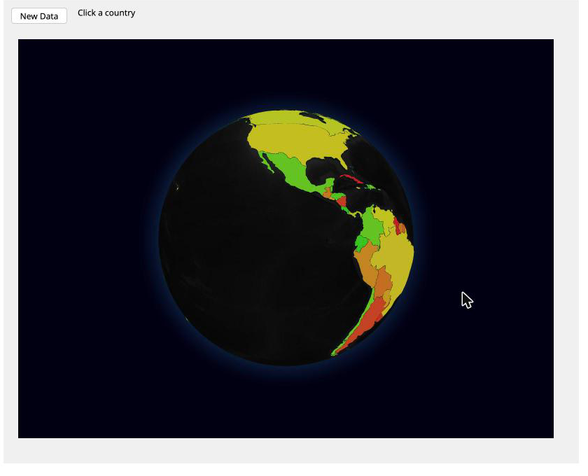

# Building a Plugin

In this tutorial we wrap [globe.gl](https://globe.gl/), a WebGL globe, as an
EWC class. We do it in five small steps, running the app after every one. By
the end you will have built this:



A `Globe` object shows a spinning 3D choropleth. Your application supplies
`Values`, which are pairs of (ISO country code, number). Countries colour
green to red by value, and clicking one fires an ordinary EWC event back to
your APL. The finished plugin lives at
[ewc-plugins/globe](https://github.com/dyalog-labs/ewc-plugins/tree/main/globe),
so you can diff against it when your version misbehaves.

You will need a working EWC checkout - see
[Installation](../Usage/Installation.md) - and a browser. That's all. This
plugin has no build step, because globe.gl ships a single CDN bundle with
three.js inside it.

Keep the [architecture page](Architecture.md) open in another tab. This page
tells you what to type; that one tells you what it means.

## Step 1 - a box on the screen

Before any globe, let's get the plugin *machinery* working end to end: a
class, a component, and proof they found each other. Make this layout:

```
globe/
  APLSource/
    Register.aplf
    Inject.aplf
    Folder.aplf
    classes/Globe/         ← seven .apla files
  assets/
    globe.js
  app/
    Start.aplf
    Initialise.aplf
```

### The class

A class definition is [seven variables](Architecture.md#defining-a-class),
one file each under `classes/Globe/`. Start with the smallest class that can
appear on a form - a type, a position, a size:

`ClassName.apla`:

```apl
'Globe'
```

`PropList.apla`. Note that `'PropList'` must list itself; the
[architecture page](Architecture.md#defining-a-class) explains why:

```apl
(
 'Type'
 'Posn'
 'Size'
 'PropList'
)
```

`Defaults.apla`, one default per property, same order:

```apl
(
 'Globe'
 10 10
 400 600
 ('Type' 'Posn' 'Size' 'PropList')
)
```

`Supported.apla` is a copy of `PropList.apla`. The remaining three -
`Dynamic.apla`, `methodlist.apla` and `SupportedEvents.apla` - are empty for
now:

```apl
0⌿(
 ''
)
```

### Register, Folder, Inject

`Register.aplf` bundles everything up and hands it to `EWC.RegisterPlugin`:

```apl
 {r}←Register;plugin;folder
⍝ Register this plugin with EWC. Safe before or after EWC.Init.
 folder←Folder

 plugin←⎕NS''
 plugin.Name←'Globe'
 plugin.Folder←folder
 plugin.Resources←'globe'(folder,'/assets')
 plugin.Classes←classes
 plugin.Inject←Inject

 r←#.EWC.RegisterPlugin plugin
```

`classes` is just the `classes/` folder - Link turns it into a namespace for
you. `Resources` tells EWC to serve `assets/` at `/globe/`
([how that works](Architecture.md#serving-static-resources)), which is what
lets `Inject.aplf` be a one-line loader:

```apl
 r←Inject
 r←'import(window.EWC.url("/globe/globe.js")).then(m => m.register(window.EWC))'
```

`Folder.aplf` finds the package root from where Link loaded it. Copy it
verbatim from any plugin in
[ewc-plugins](https://github.com/dyalog-labs/ewc-plugins); it never changes.

### The component

Now the JavaScript half. `assets/globe.js` is an ES module whose `register`
function EWC's loader calls. For step 1, the component is a labelled box:

```js
export function register(EWC) {
  const React = EWC.React;

  function GlobeChart({ data, ewc }) {
    const { Posn } = data?.Properties;
    const styles = ewc.utils.setStyle(data?.Properties);

    return React.createElement(
      'div',
      {
        id: data.ID,
        style: {
          position: 'absolute',
          top: Posn && Posn[0],
          left: Posn && Posn[1],
          background: 'midnightblue',
          color: 'white',
          overflow: 'hidden',
          ...styles,
        },
      },
      'globe goes here'
    );
  }

  EWC.registerComponent('Globe', GlobeChart);
  return 'ewc-globe: Globe registered';
}
```

Three things to notice, because they never change:

* the component is built with `EWC.React`, the client's own React, never a
  copy of your own ([why](Architecture.md#the-client-side));
* the object's `ID` goes on the outermost element;
* `ewc.utils.setStyle` turns `Posn`/`Size` into CSS exactly as the built-in
  classes do.

### The app

The demo app is two functions of ordinary EWC. If `Initialise` is new to you,
[Initialisation](../Usage/Initialisation.md) explains why the form is built
there, once per browser connection, rather than in `Start`:

```apl
 Start mode
 EWC←#.EWC
 EWC.PORT←22322

 #.GlobePlugin.Register
 EWC.Init mode
```

```apl
 Initialise connected
 EWC.CONNECTED←connected

 'F1'eWC'Form' 'Globe plugin'(30 30)(660 820)('Coord' 'Pixel')

⍝ Plugin classes nest in core containers like any other
 'F1.SF'eWC'SubForm'('Posn' 45 10)('Size' 595 790)
 'F1.SF.G'eWC'Globe'('Posn' 10 10)('Size' 570 765)

 {}eDQ'F1'
```

That [SubForm](../ObjectRef/SubForm.md) isn't load-bearing. It is there to
show that a plugin class is a first-class citizen inside core containers.

### Run it

```apl
      ]link.create /path/to/ewc/EWC
      ]link.create GlobePlugin /path/to/ewc-plugins/globe/APLSource
      ]link.create GlobeApp    /path/to/ewc-plugins/globe/app
      GlobeApp.Start 'Browser'
```

Open <http://localhost:22322/>. **You should see a midnight-blue box saying
"globe goes here".** Underwhelming, but everything difficult has already
happened. Look at your session log:

```
D:  Registered plugin "Globe", classes:  Globe
...
T:  {"WX":{"ID":"F1","Info":["import(window.EWC.url(\"/globe/globe.js\"))..."],"Method":"EvalJS"...
R:  {"WX":{"Info":[[0,"ewc-globe: Globe registered"]]...
T:  {"WC":{"ID":"F1.SF.G","Properties":{"Posn":[10,10],"Size":[570,765],"Type":"Globe"}}}
```

The `⎕WC` of your first Globe is what made EWC inject the module into the
client - [once per connection, before the object is
handled](Architecture.md#injecting-client-code) - and only then was the `WC`
sent. Your class round-tripped: APL → registry → browser → pixels.

From here on the loop is quick. After editing APL under `APLSource/`, call
`GlobePlugin.Register` again (class definitions are
[copied at registration](Architecture.md#registering-a-plugin), so
re-registering is always safe). After editing `globe.js`, just reload the
browser - the loader imports it fresh each connection.

## Step 2 - an actual globe

Replace the box with the real thing. globe.gl arrives as one script from a
CDN. We load it, and later the country polygons, behind cached promises at
the top of `globe.js`:

```js
const ENGINE_URL = 'https://unpkg.com/globe.gl';
const TEXTURE_URL = 'https://unpkg.com/three-globe/example/img/earth-dark.jpg';

let engine;
function loadEngine() {
  engine ??= new Promise((resolve, reject) => {
    const script = document.createElement('script');
    script.src = ENGINE_URL;
    script.onload = () => resolve(window.Globe);
    script.onerror = () => {
      engine = undefined; // allow a retry on the next mount
      reject(new Error(`ewc-globe: failed to load ${ENGINE_URL}`));
    };
    document.head.appendChild(script);
  });
  return engine;
}
```

Inside the component, mount the globe into our `<div>` once the engine is
ready. Add refs and an effect above the `return`:

```js
const { Posn, Size } = data?.Properties;

const nodeRef = React.useRef(null);
const globeRef = React.useRef(null);

React.useEffect(() => {
  let disposed = false;
  loadEngine()
    .then((Globe) => {
      if (disposed) return;
      const g = Globe()(nodeRef.current)
        .width(Size?.[1] ?? 600)
        .height(Size?.[0] ?? 400)
        .globeImageUrl(TEXTURE_URL);
      g.controls().autoRotate = true;
      g.controls().autoRotateSpeed = 1.2;
      globeRef.current = g;
    })
    .catch((e) => console.error(String(e)));
  return () => {
    disposed = true;
    globeRef.current?._destructor?.();
    globeRef.current = null;
  };
}, []);
```

Then change the `return` to drop the caption and the blue background. The
globe fills the div itself (keep `ref: nodeRef` on it):

```js
return React.createElement('div', {
  id: data.ID,
  ref: nodeRef,
  style: {
    position: 'absolute',
    top: Posn && Posn[0],
    left: Posn && Posn[1],
    overflow: 'hidden',
    ...styles,
  },
});
```

Reload the browser. **You should see the Earth, slowly turning, on a black
starless sky.** No APL changed in this step, and that's the point: the
library is entirely the component's business. If you see nothing, the browser
console is the place to look - a failed CDN load logs there.

## Step 3 - colour it with your data

Now for the interesting part, where data crosses the boundary from APL. The
component will accept pairs of (ISO-3166 alpha-3 code, number) and paint each
country.

First, the class grows a property. You might reach for the name `Data`, and
then stare at a grey globe wondering why the component never receives it.
`Data` is `⎕WC`'s server-side user-data property, one of a few names that
[never reach the client](Architecture.md#property-names-that-never-reach-the-client).
So use `Values` instead. Add it to `PropList.apla` and `Supported.apla`:

```apl
(
 'Type'
 'Posn'
 'Size'
 'Values'
 'PropList'
)
```

and a default (`⍬`, meaning no data) in the matching position in
`Defaults.apla`:

```apl
(
 'Globe'
 10 10
 400 600
 ⍬
 ('Type' 'Posn' 'Size' 'Values' 'PropList')
)
```

Call `GlobePlugin.Register` again to pick the class up.

On the JavaScript side we need the country outlines, which is one more CDN
fetch next to `loadEngine`:

```js
const COUNTRIES_URL =
  'https://raw.githubusercontent.com/vasturiano/globe.gl/master/example/datasets/ne_110m_admin_0_countries.geojson';

let countries;
function loadCountries() {
  countries ??= fetch(COUNTRIES_URL).then((r) => r.json());
  return countries;
}
```

In the component, turn `Values` into a lookup that the colour accessors read
*through a ref*. That is what will let a later `⎕WS` recolour the globe
without re-mounting anything:

```js
const { Posn, Size, Values } = data?.Properties;

const valuesRef = React.useRef(new Map());
valuesRef.current = new Map((Values || []).map(([c, v]) => [c, v]));
const max = Math.max(1, ...valuesRef.current.values());
const maxRef = React.useRef(max);
maxRef.current = max;

// Natural Earth marks a few countries (France, Norway) ISO_A3 = "-99"
const iso = (f) =>
  f.properties.ISO_A3 === '-99' ? f.properties.ADM0_A3 : f.properties.ISO_A3;

const capColor = (f) => {
  const v = valuesRef.current.get(iso(f));
  if (v == null) return 'rgba(100,100,100,0.55)';
  return `hsl(${Math.round(120 - (120 * v) / maxRef.current)},70%,45%)`;
};
const label = (f) =>
  `<b>${f.properties.ADMIN}</b>: ${valuesRef.current.get(iso(f)) ?? 'no data'}`;
```

Then extend the mount effect. Wait for both promises, and give the globe its
polygon layer. Everything after the polygon setup - the `controls()` calls,
`globeRef.current = g`, the `.catch` and the cleanup - is unchanged from
step 2:

```js
Promise.all([loadEngine(), loadCountries()])
  .then(([Globe, geo]) => {
    if (disposed) return;
    const feats = geo.features.filter((f) => f.properties.ISO_A2 !== 'AQ');
    const g = Globe()(nodeRef.current)
      .width(Size?.[1] ?? 600)
      .height(Size?.[0] ?? 400)
      .globeImageUrl(TEXTURE_URL)
      .polygonsData(feats)
      .polygonAltitude(0.01)
      .polygonCapColor(capColor)
      .polygonSideColor(() => 'rgba(0,60,60,0.3)')
      .polygonStrokeColor(() => '#111')
      .polygonLabel(label)
      .polygonsTransitionDuration(300);
    g.onPolygonHover((h) => g.polygonAltitude((f) => (f === h ? 0.06 : 0.01)));
```

Finally, send some data from the app. The finished plugin's
[`RandomData`](https://github.com/dyalog-labs/ewc-plugins/blob/main/globe/app/RandomData.aplf)
makes pairs for around 160 countries and randomly leaves about 10% out. To
start with, a handful will do. In `Initialise`:

```apl
 data←('GBR' 77)('FRA' 12)('BRA' 95)('JPN' 41)('AUS' 66)
 'F1.SF.G'eWC'Globe'('Posn' 10 10)('Size' 570 765)('Values'↑data)
```

Reload. **Five countries are coloured, the rest sit grey, and hovering any
country names it** - with its value, or "no data". The grey is deliberate:
those countries have no data, and a choropleth should say so.

## Step 4 - events back to APL

So far data flows one way. Let's make a click on a country arrive in APL as
an ordinary event, like a [Button](../ObjectRef/Button.md)'s `Select`.

Declare the event in the class, so `SupportedEvents.apla` stops being empty:

```apl
(
 'click'
)
```

Call `GlobePlugin.Register` again. In the component's mount effect, wire the
handler, but only when the application actually registered a callback.
Sending events nobody asked for is noise:

```js
if ((Event || []).some((e) => e[0] === 'click')) {
  g.onPolygonClick((f) =>
    ewc.socket.send(
      JSON.stringify({
        Event: {
          EventName: 'click',
          ID: data.ID,
          Info: [iso(f), f.properties.ADMIN, valuesRef.current.get(iso(f)) ?? 0],
        },
      })
    )
  );
}
```

`Event` joins the destructuring of `data?.Properties`, and `'Event'` joins
`PropList`, `Supported` and `Defaults`, with a default of `''`.

`ewc.socket` is the client's own WebSocket, handed to every plugin component.
Whatever you put in `Info` arrives as the event's arguments
([events](Architecture.md#events)). In the app, register a callback and give
it somewhere to write:

```apl
 'F1.OUT'eWC'Label' 'Click a country'(10 105)(23 500)
 'F1.SF.G'eWC'Globe'('Posn' 10 10)('Size' 570 765)('Values'↑data)('Event' 'click' 'CBGlobe')
```

```apl
 CBGlobe args;info
⍝ Info is (code name value), sent by the plugin's component
 info←2↓args
 'F1.OUT'eWS'Caption'((2⊃info),' (',(⊃info),'): ',⍕3⊃info)
```

Reload, then click a country. **The label reads something like
`United Kingdom (GBR): 77`.** Your component is now a full participant in the
EWC event loop. The callback, the `args` shape and the `eWS` reply are
exactly what any built-in class would involve.

## Step 5 - live updates

One last flow: APL changing a property on a living object. Add a button:

```apl
 'F1.NEW'eWC'Button' 'New Data'(10 10)(23 80)('Event' 'Select' 'CBNewData')
```

```apl
 CBNewData args
 'F1.SF.G'eWS'Values'RandomData
 'F1.OUT'eWS'Caption' 'new data values generated'
```

On the component side this costs three lines, because step 3 already routed
the accessors through `valuesRef`. When `Values` changes, re-apply them and
globe.gl animates the recolour itself:

```js
React.useEffect(() => {
  const g = globeRef.current;
  if (!g) return;
  g.polygonCapColor(capColor).polygonLabel(label);
}, [Values]);
```

Reload and press New Data a few times. **The whole planet ripples into a new
colouring each press.** That's the screenshot at the top of this page.
`GlobeApp.Start 'Desktop'` gives you the same thing in its own native window,
and [Multi mode](../Usage/Initialisation.md) gives every browser its own
globe with its own data.

## What you just learned

Each step exercised one seam of the
[plugin architecture](Architecture.md), and together they are the whole of
it:

1. class → registry → injection → component (the contract)
2. the library is the component's private business
3. properties carry data in (and why one of them couldn't be called `Data`)
4. `ewc.socket` carries events out
5. `⎕WS` mutates live objects

Swap the library and the shape stays the same. Name your properties and
events in the class, map them in the component, and copy everything else
unchanged. The other plugins are worked examples:
[fireworks](https://github.com/dyalog-labs/ewc-plugins/tree/main/fireworks)
is the smallest complete one,
[apexcharts](https://github.com/dyalog-labs/ewc-plugins/tree/main/apexcharts)
reads a `Dynamic` property back from the browser, and
[kendo](https://github.com/dyalog-labs/ewc-plugins/tree/main/kendo) adds a
build step to wrap a commercial library.
